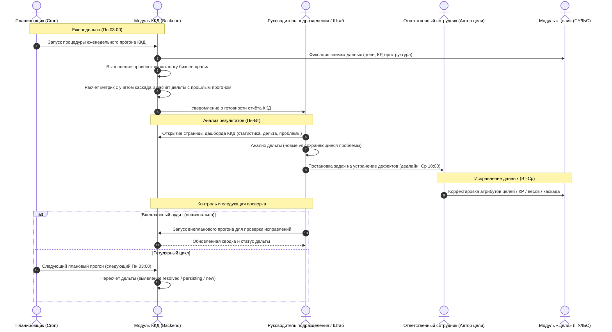

# Решение тестового задания для Бизнес-аналитика (BA)
## Проект: «Автоматизация процедуры контроля качества данных по целям сотрудников (модуль ККД)»

---

## 1. Ключевые вопросы к заказчику и стейкхолдерам

Для старта проектирования и снятия неопределённости сформирован перечень из 6 целевых вопросов к ключевым стейкхолдерам процесса:

| № | Кому адресован вопрос | Формулировка вопроса | Зачем задаём (цель вопроса) | Какой риск закрываем |
|---|---|---|---|---|
| **1** | **Владелец системы управления целями (Product Owner / CPO)** | По какому графику и в какой момент времени должен фиксироваться снимок данных для ККД (например, каждый понедельник в 03:00) и допускается ли запуск внеплановых перерасчётов по требованию пользователя? | Определить периодичность, триггеры запуска проверок и требования к фиксации исторических срезов данных (снимков). | **Риск рассинхронизации данных:** если снимок не зафиксирован в единый момент, пользователи увидят плавающие данные в процессе активного редактирования целей. |
| **2** | **Руководитель департамента (бизнес-заказчик)** | Какие пороговые значения метрик качества данных (SLA/KPI) считаются критическими (например, доля корректных целей ниже 80%), требующими обязательной блокировки отчётов или эскалации на топ-менеджмент? | Выделить критические бизнес-триггеры для управленческих решений и цветовой индикации в дашборде. | **Риск низкой вовлечённости:** отсутствие чётких порогов превратит модуль в пассивную статистику без стимулов к реальному исправлению данных. |
| **3** | **Ответственный за целеполагание в подразделении (Штаб / HR-координатор)** | Какой регламентный срок отводится на исправление выявленных дефектов с момента публикации результатов еженедельного прогона (например, до среды 18:00 текущей недели)? | Установить SLA процесса исправления данных между еженедельными проверками и настроить отслеживание дельты (`persisting`). | **Риск затягивания дефектов:** без дедлайна проблемы переходят из прогона в прогон без персональной ответственности. |
| **4** | **Владелец системы управления целями (Архитектор / Tech Lead)** | Какие правила каскадирования являются обязательными для сквозных целей между подразделениями разного подчинения (кросс-функциональные/матричные цели)? | Формализовать бизнес-логику связывания целей: допускается ли привязка к цели подразделения из смежной вертикали или только строго вверх по дереву иерархии подразделений. | **Риск ложных срабатываний (False Positives):** блокировка корректных кросс-блочных инициатив правилом `CASCADE_WRONG_LEVEL`. |
| **5** | **Системный администратор / Администратор модуля ККД** | Какова матрица доступа к модулю: имеют ли руководители подразделений доступ к просмотру проблем смежных подразделений и кто имеет право запускать внеплановый прогон или вносить исключения из правил? | Определить ролевую модель (RBAC), область видимости данных и сценарии аудита действий пользователей. | **Риск утечки конфиденциальной информации** о персональных КПЭ сотрудников и перегрузки сервиса частыми внеплановыми пересчетами. |
| **6** | **Ответственный за целеполагание / Руководитель подразделения** | Что считается допустимым жизненным циклом цели при её корректировке в середине квартала (например, архивация/отмена цели и её влияние на дочерние цели подчиненных)? | Определить поведение системы, если родительская цель отменяется: что происходит с каскадированными целями сотрудников. | **Риск накопления «осиротевших» целей** в системе, искажающих общую картину выполнения бизнес-стратегии. |

---

## 2. Каталог бизнес-правил ККД

В соответствии с требованиями выбраны 4 ключевых правила контроля качества (включая критические дефекты и правило каскадирования), сформулированные на языке бизнеса:

### Правило 1. Назначение персональной ответственности
* **Код правила:** `GOAL_NO_OWNER`
* **Название на языке бизнеса:** «Цель без назначенного ответственного»
* **Объект проверки:** Цель (Goal)
* **Уровень важности:** **Critical** (Критичный)
* **Обоснование важности:** Если за цель никто персонально не отвечает, прогресс по ней не отслеживается, результаты не с кого спросить, а мотивационная составляющая процесса целеполагания полностью разрушается. В управленческой отчётности такая цель становится «ничейной».
* **Рекомендация пользователю:** *«Перейдите в карточку цели в модуле «Цели» и укажите ответственного сотрудника из структуры подразделения.»*

### Правило 2. Наличие измеримых результатов
* **Код правила:** `GOAL_NO_KR`
* **Название на языке бизнеса:** «Активная цель без измеримых ключевых результатов»
* **Объект проверки:** Цель (Goal)
* **Уровень важности:** **Critical** (Критичный)
* **Обоснование важности:** Цель без ключевых результатов (КР) носит декларативный характер. Невозможно объективно и математически оценить процент её выполнения по итогам отчётного периода, что делает мониторинг стратегии невозможным.
* **Рекомендация пользователю:** *«Добавьте к цели от 1 до 5 ключевых результатов с целевыми числовыми значениями и единицами измерения.»*

### Правило 3. Сбалансированность весов ключевых результатов
* **Код правила:** `KR_WEIGHTS_SUM`
* **Название на языке бизнеса:** «Несбалансированные веса ключевых результатов (сумма ≠ 100%)»
* **Объект проверки:** Цель (Goal)
* **Уровень важности:** **Major** (Существенный)
* **Обоснование важности:** Вес каждого КР определяет его вклад в итоговое достижение цели. Если сумма весов превышает 100% или меньше 100%, алгоритм расчёта совокупного прогресса по цели и итогового бонуса сотрудника искажается (возникает недооценка или переоценка вклада).
* **Рекомендация пользователю:** *«Откройте список ключевых результатов цели и скорректируйте их процентные веса так, чтобы их сумма составляла ровно 100%.»*

### Правило 4. Непрерывность стратегического каскада
* **Код правила:** `CASCADE_NO_PARENT`
* **Название на языке бизнеса:** «Разрыв стратегического каскада (цель не привязана к цели руководителя)»
* **Объект проверки:** Цель (Goal уровня департамента, подразделения или сотрудника)
* **Уровень важности:** **Major** (Существенный)
* **Обоснование важности:** Система целеполагания строится по принципу декомпозиции: цели сотрудников и отделов должны напрямую работать на достижение стратегических целей блока и департамента. Несвязанная цель создаёт риск рассинхронизации усилий команды со стратегией компании.
* **Рекомендация пользователю:** *«Укажите родительскую цель вышестоящего уровня в структуре вашего департамента или блока.»*

---

## 3. Метрики качества данных

Для комплексного анализа качества данных на уровне руководства разработана система из 3 ключевых метрик:

### Метрика 1. Доля корректных целей (`clean_goals_share`)
* **Что измеряем:** Процент активных целей подразделения, по которым не зафиксировано ни одного нарушения (как по самой цели, так и по всем её ключевым результатам).
* **Формула:**  
  $$\text{Clean Goals Share} = \frac{N_{\text{целей без замечаний}}}{N_{\text{всех активных целей}}} \times 100\%$$
* **Зачем руководителю:** Служит интегральным KPI качества процесса целеполагания. Позволяет руководителю департамента в одной цифре оценить «здоровье» реестра целей и сравнивать подразделения между собой.
* **Что считается «лучше»:** **Рост (чем выше %, тем лучше).** Целевой ориентир — от 90% и выше.

### Метрика 2. Покрытие стратегическим каскадом (`cascade_coverage`)
* **Что измеряем:** Долю целей подразделения и сотрудников (все цели ниже уровня блока), корректно привязанных к действующим родительским целям вышестоящего уровня без разрывов и циклов.
* **Формула:**  
  $$\text{Cascade Coverage} = \frac{N_{\text{каскадированных целей без нарушений}}}{N_{\text{всех не-корневых активных целей}}} \times 100\%$$
* **Зачем руководителю:** Показывает степень синхронизации сотрудников с бизнес-стратегией банка. Выявляет «автономные» цели, которые не вносят вклад в ключевые приоритеты руководства.
* **Что считается «лучше»:** **Рост (чем выше %, тем лучше).** Идеальное значение — 100%.

### Метрика 3. Количество критических проблем (`critical_issues`)
* **Что измеряем:** Абсолютное число нарушений с наивысшим приоритетом (`critical`), выявленных в подразделении и его дочерних структурах на момент прогона.
* **Формула:**  
  $$\text{Critical Issues} = \sum \text{нарушений с уровнем } \text{severity} = \text{'critical'}$$
* **Зачем руководителю:** Определяет список задач первоочередной срочности («блокеров»). Если число критических дефектов > 0, автоматизированный расчёт бонусов и агрегированная отчётность для топ-менеджмента признаются недостоверными.
* **Что считается «лучше»:** **Снижение (чем меньше, тем лучше).** Целевой показатель — ровно 0.

---

## 4. Описание бизнес-процесса TO BE

### 4.1. Схема процесса (User Flow / Sequence)



### 4.2. Текстовое описание регламента TO BE

1. **Еженедельный автоматический прогон:**
   * Каждый понедельник в 03:00 сервис ККД делает неизменяемый снимок (snapshot) всех целей и КР в БД.
   * Выполняются 100% бизнес-правил, сохраняется реестр найденных дефектов и рассчитывается дельта со снимком предыдущего успешного прогона.
2. **Просмотр результатов и постановка задач:**
   * В понедельник утром руководитель департамента и ответственный за целеполагание открывают интерфейс модуля ККД.
   * На главной странице сразу видна динамика (лучше/хуже), число критических блокеров и фильтр по новым проблемам (`new`).
   * Руководитель в 1 клик фильтрует список критических проблем и направляет задачи ответственным сотрудникам.
3. **Исправление в системе-источнике:**
   * Сотрудники вносят исправления непосредственно в модуль «Цели» (ПУЛЬС) согласно рекомендациям из карточки проблемы.
4. **Ответственность и порядок эскалации:**
   * **Кто отвечает за исправление:** Персональную ответственность за исправление несет автор/ответственный по цели; общий контроль за подразделением осуществляет руководитель штаба.
   * **Что происходит, если проблема не исправлена к следующему прогону (`persisting`):**
     * Если проблема не устранена за 7 дней (1 цикл), она помечается статусом `persisting` со счётчиком прогонов подряд (`runs_in_row >= 2`).
     * При сохранении критической проблемы более 2 прогонов подряд система формирует автоматический эскалационный список, отправляемый куратору блока (вице-президенту).
     * Цели с неустранёнными критическими дефектами блокируются для начисления квартального премирования до момента полного закрытия замечаний ККД.

---

## 5. Контрольные приёмочные сценарии (Acceptance Criteria)

Сценарии формализованы в формате **Gherkin (Дано / Когда / Тогда)** для автоматизированной проверки и приёмки бизнес-заказчиком:

### Сценарий 1: Проверка цели без ответственного сотрудника
```gherkin
Сценарий: Выявление активной цели без ответственного лица
  Дано: В подразделении «Управление региональных продаж» создана цель «Увеличить продажи в СЗФО» со статусом «active»
  И: Поле «Ответственный» у данной цели не заполнено (значение NULL)
  Когда: Модуль ККД выполняет процедуру проверки качества данных
  Тогда: По цели регистрируется нарушение с кодом «GOAL_NO_OWNER»
  И: Уровень важности нарушения равен «critical»
  И: Рекомендация содержит текст: «Назначить ответственного за цель в модуле «Цели»»
  И: Данная цель учитывается как дефектная в расчёте метрики «Доля корректных целей»
```

### Сценарий 2: Контроль баланса весов ключевых результатов
```gherkin
Сценарий: Выявление несоответствия суммы весов КР нормативу 100%
  Дано: У активной цели заведены 2 ключевых результата
  И: Вес первого КР равен 40%, а вес второго КР равен 50% (общая сумма 90%)
  Когда: Запускается процедура расчёта ККД
  Тогда: Регистрируется нарушение правила «KR_WEIGHTS_SUM» с уровнем важности «major»
  И: В деталях проблемы отображается: фактическое значение «90%», ожидаемое значение «100%»
  И: В рекомендации указано: «Перераспределить веса КР так, чтобы сумма была 100%»
```

### Сценарий 3: Неразрывность стратегического каскадирования
```gherkin
Сценарий: Проверка цели уровня отдела на наличие связи с целью вышестоящего уровня
  Дано: В отделе «Отдел торгового финансирования» заведена активная цель уровня «unit»
  И: У цели отсутствует ссылка на родительскую цель («parent_id» равен NULL)
  Когда: Выполняется еженедельный прогон ККД
  Тогда: Фиксируется нарушение правила «CASCADE_NO_PARENT» с уровнем «major»
  И: Метрика подразделения «Покрытие каскадом» уменьшается пропорционально весу данной цели
```

### Сценарий 4: Отражение дельты исправленной проблемы
```gherkin
Сценарий: Отображение успешного исправления проблемы в следующем прогоне
  Дано: В прогоне RUN-001 у цели GOAL-10 было зафиксировано нарушение «GOAL_NO_OWNER»
  И: Пользователь назначил ответственного сотрудника до запуска прогона RUN-002
  Когда: Выполняется прогон RUN-002
  Тогда: В прогоне RUN-002 нарушение «GOAL_NO_OWNER» по цели GOAL-10 не входит в активный список проблем
  И: В сводке прогона RUN-002 счётчик «delta.resolved» увеличивается на 1
  И: При фильтрации по статусу дельты «resolved» данная проблема отображается со статусом «Исправлена»
```

---

## 6. Мотивация участия в проекте

* **Почему тебе интересен этот проект?**  
  Проект «Автотрекинг целей B2B+» решает фундаментальную задачу прозрачности управления масштабным бизнесом. Создание модуля ККД находится на стыке аналитики данных, продуктового менеджмента и бизнес-архитектуры. Мне интересно разработать инструмент, который не просто фиксирует технические ошибки, а реально повышает дисциплину целеполагания и влияет на принятие стратегических решений топ-менеджментом банка.
* **Как ты видишь свою роль в команде, которая создаёт продукт?**  
  Как бизнес-аналитик, я выступаю связующим мостом между бизнес-заказчиками (руководителями блоков, штабами) и IT-командой. Моя цель — трансформировать высокоуровневые бизнес-потребности в однозначные, математически точные требования, правила и сценарии приёмки, снимая любые двусмысленности до начала кодирования, а также обеспечивать бизнес-валидацию поставляемых инкрементов.
* **Сколько времени в неделю ты готов(а) уделять проекту и в течение какого периода?**  
  Готов(а) уделять проекту от 20 до 30 часов в неделю на протяжении всего жизненного цикла разработки и пилотирования (от 3 до 6 месяцев и далее до стабильной промышленной эксплуатации).
