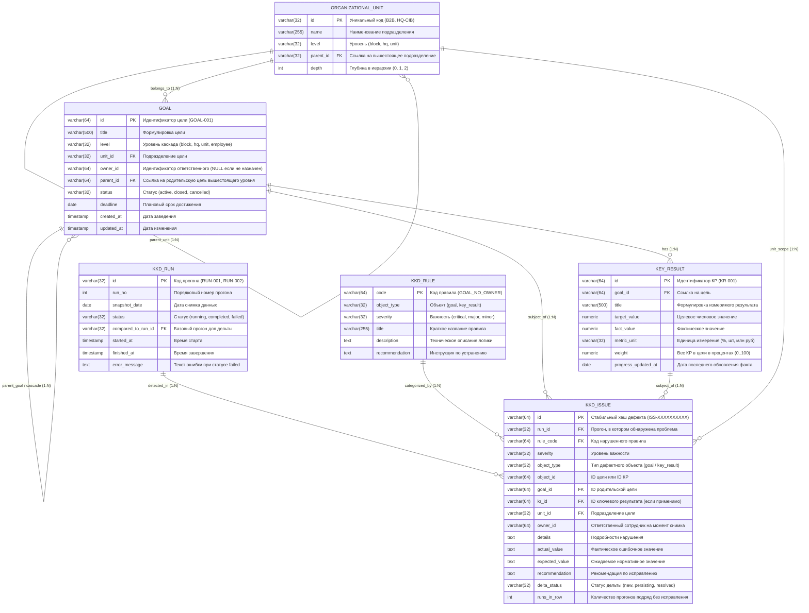

# Решение тестового задания для Системного аналитика (SA)
## Проект: «Автоматизация процедуры контроля качества данных по целям сотрудников (модуль ККД)»

---

## 1. Модель данных (Data Model)

Модель данных спроектирована под реляционную СУБД **PostgreSQL 15+** с учётом версионирования снимков (snapshots) и сохранения истории проверок.

### 1.1. ER-диаграмма (Entity-Relationship)



### 1.2. Реляционная спецификация таблиц (Схема PostgreSQL)

1. **`organizational_units` (Подразделения):**
   * `id VARCHAR(32) PRIMARY KEY` — символьный идентификатор (`B2B`, `HQ-CIB`, `CIB-KEY`);
   * `name VARCHAR(255) NOT NULL` — наименование подразделения;
   * `level VARCHAR(32) NOT NULL` — уровень (`block`, `hq`, `unit`);
   * `parent_id VARCHAR(32) REFERENCES organizational_units(id)` — родительский узел (NULL для корня `B2B`);
   * `depth INT NOT NULL DEFAULT 0` — глубина вложенности (`0` для блока, `1` для департамента, `2` для отдела).
   * *Индексы:* `CREATE INDEX idx_units_parent ON organizational_units(parent_id);`

2. **`goals` (Цели):**
   * `id VARCHAR(64) PRIMARY KEY` — идентификатор цели;
   * `title VARCHAR(500) NOT NULL` — формулировка цели;
   * `level VARCHAR(32) NOT NULL` — уровень каскада (`block`, `hq`, `unit`, `employee`);
   * `unit_id VARCHAR(32) NOT NULL REFERENCES organizational_units(id)` — подразделение;
   * `owner_id VARCHAR(64)` — табельный номер/ID ответственного (может быть NULL при нарушении);
   * `parent_id VARCHAR(64) REFERENCES goals(id)` — родительская цель вышестоящего уровня (NULL для корневых);
   * `status VARCHAR(32) NOT NULL` — статус цели (`active`, `closed`, `cancelled`);
   * `deadline DATE NOT NULL` — целевой срок исполнения;
   * `created_at TIMESTAMP WITH TIME ZONE DEFAULT NOW()`;
   * `updated_at TIMESTAMP WITH TIME ZONE DEFAULT NOW()`.
   * *Индексы:* `CREATE INDEX idx_goals_unit_status ON goals(unit_id, status);`, `CREATE INDEX idx_goals_parent ON goals(parent_id);`

3. **`key_results` (Ключевые результаты):**
   * `id VARCHAR(64) PRIMARY KEY` — идентификатор КР;
   * `goal_id VARCHAR(64) NOT NULL REFERENCES goals(id) ON DELETE CASCADE`;
   * `title VARCHAR(500) NOT NULL` — наименование измеримого результата;
   * `target_value NUMERIC(15, 2)` — целевое числовое значение (может быть NULL при дефекте);
   * `fact_value NUMERIC(15, 2) NOT NULL DEFAULT 0` — текущее фактическое значение;
   * `metric_unit VARCHAR(32)` — единица измерения (`%`, `шт.`, `млн руб.`);
   * `weight NUMERIC(5, 2) NOT NULL DEFAULT 0` — вес КР в цели (0.00 .. 100.00);
   * `progress_updated_at DATE NOT NULL` — дата последнего обновления фактического значения.
   * *Индексы:* `CREATE INDEX idx_kr_goal ON key_results(goal_id);`

4. **`kkd_rules` (Справочник правил ККД):**
   * `code VARCHAR(64) PRIMARY KEY` — код правила (`GOAL_NO_OWNER`, `CASCADE_NO_PARENT`);
   * `object_type VARCHAR(32) NOT NULL` — `goal` или `key_result`;
   * `severity VARCHAR(32) NOT NULL` — `critical`, `major`, `minor`;
   * `title VARCHAR(255) NOT NULL`;
   * `description TEXT NOT NULL`;
   * `recommendation TEXT NOT NULL`.

5. **`kkd_runs` (Журнал прогонов):**
   * `id VARCHAR(32) PRIMARY KEY` — код прогона (`RUN-001`, `RUN-002`);
   * `run_no INT NOT NULL UNIQUE` — строго возрастающий номер;
   * `snapshot_date DATE NOT NULL` — дата среза данных;
   * `status VARCHAR(32) NOT NULL` — `running`, `completed`, `failed`;
   * `compared_to_run_id VARCHAR(32) REFERENCES kkd_runs(id)` — базовый прогон сравнения;
   * `started_at TIMESTAMP WITH TIME ZONE NOT NULL DEFAULT NOW()`;
   * `finished_at TIMESTAMP WITH TIME ZONE`;
   * `error_message TEXT`.
   * *Индексы:* `CREATE INDEX idx_runs_status ON kkd_runs(status, run_no DESC);`

6. **`kkd_issues` (Найденные проблемы снимка):**
   * `id VARCHAR(64) NOT NULL` — детерминированный SHA1-хеш отпечатка: `ISS-` + SHA1(`rule_code:object_id`)[:10];
   * `run_id VARCHAR(32) NOT NULL REFERENCES kkd_runs(id) ON DELETE CASCADE`;
   * `rule_code VARCHAR(64) NOT NULL REFERENCES kkd_rules(code)`;
   * `severity VARCHAR(32) NOT NULL`;
   * `object_type VARCHAR(32) NOT NULL`;
   * `object_id VARCHAR(64) NOT NULL`;
   * `goal_id VARCHAR(64) NOT NULL REFERENCES goals(id)`;
   * `kr_id VARCHAR(64) REFERENCES key_results(id)`;
   * `unit_id VARCHAR(32) NOT NULL REFERENCES organizational_units(id)`;
   * `owner_id VARCHAR(64)`;
   * `details TEXT NOT NULL`;
   * `actual_value TEXT`;
   * `expected_value TEXT`;
   * `recommendation TEXT NOT NULL`;
   * `delta_status VARCHAR(32) NOT NULL` — `new`, `persisting`, `resolved`;
   * `runs_in_row INT NOT NULL DEFAULT 1`;
   * `PRIMARY KEY (run_id, id)`.
   * *Индексы:* `CREATE INDEX idx_issues_unit ON kkd_issues(run_id, unit_id);`, `CREATE INDEX idx_issues_rule_sev ON kkd_issues(run_id, rule_code, severity);`

---

## 2. Формализация 4 правил проверки

### Определение активной цели
В соответствии с корпоративной моделью:
> **Активная цель** — запись в таблице `goals`, удовлетворяющая предикату:
> `status = 'active'`.  
> Закрытые (`status = 'closed'`) и отменённые (`status = 'cancelled'`) цели и их КР исключаются из проверок ККД.

---

### Правило 1: `GOAL_NO_OWNER`
* **Объект проверки:** Цель (`goal`)
* **Уровень важности:** `critical`
* **Название:** Цель без ответственного
* **Условие нарушения текстом:** У цели в статусе `active` отсутствует ссылка на ответственного сотрудника (поле `owner_id IS NULL` или строка из пробелов).
* **SQL-условие выявления нарушения:**
```sql
SELECT 
    g.id AS object_id,
    g.id AS goal_id,
    NULL::varchar AS kr_id,
    g.unit_id,
    g.owner_id,
    'GOAL_NO_OWNER' AS rule_code,
    'critical' AS severity,
    'Поле «Ответственный» не заполнено' AS details,
    NULL::text AS actual_value,
    'сотрудник' AS expected_value
FROM goals g
WHERE g.status = 'active'
  AND (g.owner_id IS NULL OR TRIM(g.owner_id) = '');
```

---

### Правило 2: `GOAL_NO_KR`
* **Объект проверки:** Цель (`goal`)
* **Уровень важности:** `critical`
* **Название:** Цель без ключевых результатов
* **Условие нарушения текстом:** У цели в статусе `active` нет ни одной дочерней записи в таблице `key_results` (количество привязанных КР равно 0).
* **SQL-условие выявления нарушения:**
```sql
SELECT 
    g.id AS object_id,
    g.id AS goal_id,
    NULL::varchar AS kr_id,
    g.unit_id,
    g.owner_id,
    'GOAL_NO_KR' AS rule_code,
    'critical' AS severity,
    'У активной цели 0 ключевых результатов' AS details,
    '0' AS actual_value,
    '>= 1' AS expected_value
FROM goals g
LEFT JOIN key_results kr ON kr.goal_id = g.id
WHERE g.status = 'active'
GROUP BY g.id, g.unit_id, g.owner_id
HAVING COUNT(kr.id) = 0;
```

---

### Правило 3: `KR_WEIGHTS_SUM`
* **Объект проверки:** Цель (`goal`)
* **Уровень важности:** `major`
* **Название:** Сумма весов КР не равна 100%
* **Условие нарушения текстом:** У активной цели, имеющей хотя бы один КР, суммарный вес всех связанных КР математически отличается от 100% (допустимая погрешность округления: $\pm 0.01\%$).
* **SQL-условие выявления нарушения:**
```sql
SELECT 
    g.id AS object_id,
    g.id AS goal_id,
    NULL::varchar AS kr_id,
    g.unit_id,
    g.owner_id,
    'KR_WEIGHTS_SUM' AS rule_code,
    'major' AS severity,
    CONCAT('Сумма весов КР = ', ROUND(SUM(kr.weight), 2), '%, ожидается 100%') AS details,
    ROUND(SUM(kr.weight), 2)::text AS actual_value,
    '100' AS expected_value
FROM goals g
JOIN key_results kr ON kr.goal_id = g.id
WHERE g.status = 'active'
GROUP BY g.id, g.unit_id, g.owner_id
HAVING ABS(SUM(kr.weight) - 100.00) > 0.01;
```

---

### Правило 4: `CASCADE_NO_PARENT` (Правило на каскадирование)
* **Объект проверки:** Цель (`goal`)
* **Уровень важности:** `major`
* **Название:** Цель не связана с целью вышестоящего уровня
* **Условие нарушения текстом:** Активная цель любого уровня, кроме корневого уровня блока (`level != 'block'`), не имеет указанной родительской цели (`parent_id IS NULL` либо ссылка указывает на несуществующую цель).
* **SQL-условие выявления нарушения:**
```sql
SELECT 
    g.id AS object_id,
    g.id AS goal_id,
    NULL::varchar AS kr_id,
    g.unit_id,
    g.owner_id,
    'CASCADE_NO_PARENT' AS rule_code,
    'major' AS severity,
    'Родительская цель вышестоящего уровня не указана' AS details,
    NULL::text AS actual_value,
    'цель вышестоящего уровня' AS expected_value
FROM goals g
WHERE g.status = 'active'
  AND g.level <> 'block'
  AND (g.parent_id IS NULL OR NOT EXISTS (SELECT 1 FROM goals p WHERE p.id = g.parent_id));
```

---

## 3. Расчёт метрик качества данных и иерархическая агрегация

### 3.1. Алгоритм иерархической агрегации (Descendants or Self)
В соответствии с бизнес-требованиями метрики выбранного подразделения $U$ рассчитываются **кумулятивно** — по всем активным целям подразделения $U$ и **всех его дочерних подразделений любого уровня вложенности**.

Множество релевантных подразделений $\text{Scope}(U)$ определяется рекурсивным выражением:
```sql
WITH RECURSIVE unit_hierarchy AS (
    SELECT id FROM organizational_units WHERE id = :target_unit_id
    UNION ALL
    SELECT u.id FROM organizational_units u
    JOIN unit_hierarchy uh ON u.parent_id = uh.id
)
SELECT id FROM unit_hierarchy;
```

---

### 3.2. Спецификация 3 ключевых метрик

#### Метрика 1: `clean_goals_share` (Доля корректных целей)
* **Единица измерения:** Проценты (`%`), точность до 1 знака после запятой.
* **Направление оптимизации:** **Рост (чем выше %, тем лучше).**
* **Математическая формула:**
  $$\text{clean\_goals\_share} = \begin{cases} 
  \text{round}\left(\frac{|\mathcal{G}_{\text{scope}} \setminus \mathcal{G}_{\text{defect}}|}{|\mathcal{G}_{\text{scope}}|} \times 100, 1\right), & \text{если } |\mathcal{G}_{\text{scope}}| > 0 \\ 
  \text{null}, & \text{если } |\mathcal{G}_{\text{scope}}| = 0 
  \end{cases}$$
  где:
  * $\mathcal{G}_{\text{scope}}$ — множество всех активных целей в подразделениях из $\text{Scope}(U)$;
  * $\mathcal{G}_{\text{defect}}$ — множество целей из $\mathcal{G}_{\text{scope}}$, по которым в данном прогоне зафиксировано хотя бы одно нарушение (по самой цели или любому её КР).

#### Метрика 2: `cascade_coverage` (Покрытие стратегическим каскадом)
* **Единица измерения:** Проценты (`%`), точность до 1 знака после запятой.
* **Направление оптимизации:** **Рост (чем выше %, тем лучше).**
* **Математическая формула:**
  $$\text{cascade\_coverage} = \begin{cases} 
  \text{round}\left(\frac{|\mathcal{G}_{\text{non\_block}} \setminus \mathcal{G}_{\text{cascade\_defect}}|}{|\mathcal{G}_{\text{non\_block}}|} \times 100, 1\right), & \text{если } |\mathcal{G}_{\text{non\_block}}| > 0 \\ 
  \text{null}, & \text{если } |\mathcal{G}_{\text{non\_block}}| = 0 
  \end{cases}$$
  где:
  * $\mathcal{G}_{\text{non\_block}}$ — подмножество активных целей из $\mathcal{G}_{\text{scope}}$ с уровнем `level != 'block'`;
  * $\mathcal{G}_{\text{cascade\_defect}}$ — цели из $\mathcal{G}_{\text{non\_block}}$, нарушившие правила каскада (`CASCADE_NO_PARENT`, `CASCADE_WRONG_LEVEL`, `CASCADE_PARENT_INACTIVE`).

#### Метрика 3: `issues_total` (Общее количество найденных проблем)
* **Единица измерения:** Штуки (`шт.`).
* **Направление оптимизации:** **Снижение (чем меньше число, тем лучше).**
* **Математическая формула:**
  $$\text{issues\_total} = |\mathcal{I}_{\text{scope}}|$$
  где $\mathcal{I}_{\text{scope}}$ — общее количество зарегистрированных дефектов в прогоне по подразделениям из $\text{Scope}(U)$.

---

## 4. Спецификация дельты и связи между прогонами

### 4.1. Идентификация повторных проблем («Та же самая проблема»)
Дефект однозначно идентифицируется неизменяемым составным отпечатком (**fingerprint**):
$$\text{fingerprint} = \text{rule\_code} + \text{":"} + \text{object\_id}$$
* Для дефекта цели (`object_type = 'goal'`): `GOAL_NO_OWNER:GOAL-012`
* Для дефекта ключевого результата (`object_type = 'key_result'`): `KR_NO_TARGET:KR-045`

Уникальный `id` проблемы формируется алгоритмом:
$$\text{issue\_id} = \text{"ISS-"} + \text{SHA1}(\text{fingerprint})[0..9].\text{upper()}$$
Если в прогоне $N$ и прогоне $N-1$ зафиксирована проблема с одинаковым `id` (`fingerprint`), она признается **той же самой**.

### 4.2. Классификация статусов дельты
Пусть $I_{\text{cur}}$ — множество проблем текущего прогона, $I_{\text{prev}}$ — множество проблем базового прогона сравнения:
1. **`new` (Новая):** $\text{issue} \in I_{\text{cur}} \land \text{issue} \notin I_{\text{prev}}$
2. **`persisting` (Сохраняется):** $\text{issue} \in I_{\text{cur}} \land \text{issue} \in I_{\text{prev}}$ (счётчик `runs_in_row` увеличивается на 1)
3. **`resolved` (Исправлена):** $\text{issue} \in I_{\text{prev}} \land \text{issue} \notin I_{\text{cur}}$

### 4.3. Поведение в особых состояниях
1. **Первый прогон (`RUN-001`):**
   * У первого прогона поле `compared_to_run_id = NULL`.
   * Для всех метрик значения `previous = null`, `delta = null`, `delta_pct = null`, `trend = null` (строго `null`, **не `0`**).
   * Счётчики дельты: `delta.new = null`, `delta.persisting = null`, `delta.resolved = null`.
2. **Неуспешный прогон (`status = 'failed'`):**
   * При обращении к результатам прогона со статусом `failed` API возвращает ошибку `HTTP 409 Conflict` с кодом `RUN_FAILED`.
   * При вычислении дельты последующих прогонов (например, `RUN-007` после неудачного `RUN-006`) система выбирает **последний предшествующий прогон со статусом `completed`** (то есть `RUN-005`). Прогоны `failed` и `running` при поиске базы сравнения пропускаются.

---

## 5. Контракт REST API для страницы ККД

### 5.1. Общие соглашения
* Все ответы сериализуются в формате `application/json; charset=utf-8`.
* Единый формат ошибок:
```json
{
  "error": {
    "code": "STRING_ERROR_CODE",
    "message": "Человекочитаемое описание причины ошибки"
  }
}
```
* Коды ошибок:
  * `404 Not Found` — `RUN_NOT_FOUND`, `UNIT_NOT_FOUND`, `ISSUE_NOT_FOUND`;
  * `409 Conflict` — `RUN_FAILED` (прогон завершился с ошибкой), `RUN_IN_PROGRESS` (прогон еще рассчитывается);
  * `422 Unprocessable Entity` — `INVALID_PARAM` (недопустимые значения фильтров, пагинации и т. д.).

---

### 5.2. Спецификация эндпоинтов

#### Эндпоинт 1: `GET /api/runs`
* **Назначение:** Получение истории прогонов ККД с пагинацией.
* **Параметры запроса (Query Params):**
  * `limit` (int, default: 20, min: 1, max: 100)
  * `offset` (int, default: 0, min: 0)
* **Структура ответа (200 OK):**
```json
{
  "items": [
    {
      "id": "RUN-002",
      "run_no": 2,
      "status": "completed",
      "snapshot_date": "2026-10-26",
      "compared_to_run_id": "RUN-001",
      "started_at": "2026-10-26T03:00:00Z",
      "finished_at": "2026-10-26T03:00:15Z",
      "goals_total": 24,
      "issues_total": 6,
      "critical_issues": 1
    }
  ],
  "total": 2,
  "limit": 20,
  "offset": 0
}
```

---

#### Эндпоинт 2: `GET /api/kkd/summary`
* **Назначение:** Агрегированная сводка по качеству данных выбранного подразделения.
* **Параметры запроса (Query Params):**
  * `run_id` (string, required, например `RUN-002` или `latest`)
  * `unit_id` (string, required, например `B2B` или `HQ-CIB`)
* **Поведение в граничных случаях:**
  * Если `unit_id` — новое подразделение без целей (`TX-NEW`): все относительные метрики (`clean_goals_share`, `cascade_coverage`) возвращают `value: null`, счётчики целей возвращают `0`.
  * Если `run_id` — первый прогон (`RUN-001`): `compared_to: null`, поля `previous`, `delta`, `trend` равны `null`, объект `delta` содержит `null`.
  * Если прогон завершился сбоем: возвращается `HTTP 409` с телом `{"error": {"code": "RUN_FAILED", "message": "Прогон RUN-006 завершился с ошибкой — результатов нет"}}`.
  * Если прогон еще выполняется: возвращается `HTTP 409` с телом `{"error": {"code": "RUN_IN_PROGRESS", "message": "Прогон RUN-009 ещё выполняется"}}`.

##### Полный пример ответа `GET /api/kkd/summary?run_id=RUN-002&unit_id=HQ-CIB`:
```json
{
  "run": {
    "id": "RUN-002",
    "status": "completed",
    "snapshot_date": "2026-10-26",
    "compared_to_run_id": "RUN-001"
  },
  "compared_to": {
    "id": "RUN-001",
    "status": "completed",
    "snapshot_date": "2026-10-19"
  },
  "unit": {
    "id": "HQ-CIB",
    "name": "Департамент корпоративного бизнеса",
    "level": "hq",
    "parent_id": "B2B",
    "path": [
      { "id": "B2B", "name": "Корпоративный блок" },
      { "id": "HQ-CIB", "name": "Департамент корпоративного бизнеса" }
    ]
  },
  "metrics": [
    {
      "key": "clean_goals_share",
      "title": "Доля корректных целей",
      "unit": "%",
      "higher_is_better": true,
      "formula": "активные цели без проблем ÷ все активные цели × 100",
      "value": 75.0,
      "previous": 62.5,
      "delta": 12.5,
      "delta_pct": 20.0,
      "trend": "better"
    },
    {
      "key": "cascade_coverage",
      "title": "Покрытие каскадом",
      "unit": "%",
      "higher_is_better": true,
      "formula": "цели с корректной связью ÷ все не-корневые цели × 100",
      "value": 87.5,
      "previous": 75.0,
      "delta": 12.5,
      "delta_pct": 16.7,
      "trend": "better"
    },
    {
      "key": "issues_total",
      "title": "Найдено проблем",
      "unit": "шт.",
      "higher_is_better": false,
      "formula": "общее количество нарушений правил ККД",
      "value": 4,
      "previous": 6,
      "delta": -2,
      "delta_pct": -33.3,
      "trend": "better"
    }
  ],
  "issues_by_severity": [
    { "code": "critical", "title": "Критичная", "current": 1, "previous": 2, "delta": -1 },
    { "code": "major", "title": "Существенная", "current": 3, "previous": 4, "delta": -1 },
    { "code": "minor", "title": "Незначительная", "current": 0, "previous": 0, "delta": 0 }
  ],
  "delta": {
    "new": 1,
    "persisting": 3,
    "resolved": 3
  }
}
```

---

#### Эндпоинт 3: `GET /api/kkd/issues`
* **Назначение:** Получение фильтруемого списка проблем снимка с пагинацией.
* **Параметры запроса (Query Params):**
  * `run_id` (string, required)
  * `unit_id` (string, optional, default: `B2B`)
  * `rule_code` (string, optional, перечисление через запятую)
  * `severity` (string, optional, `critical,major,minor`)
  * `delta_status` (string, optional, `new,persisting,resolved`)
  * `limit` (int, default: 20, min: 1, max: 200)
  * `offset` (int, default: 0, min: 0)
* **Структура ответа (200 OK):**
```json
{
  "run_id": "RUN-002",
  "items": [
    {
      "id": "ISS-E3A190BC44",
      "fingerprint": "GOAL_NO_OWNER:GOAL-005",
      "rule_code": "GOAL_NO_OWNER",
      "rule_title": "Цель без ответственного",
      "severity": "critical",
      "object_type": "goal",
      "object_id": "GOAL-005",
      "goal_id": "GOAL-005",
      "goal_title": "Оптимизация кредитного конвейера для крупного бизнеса",
      "kr_id": null,
      "kr_title": null,
      "unit_id": "HQ-CIB",
      "unit_name": "Департамент корпоративного бизнеса",
      "owner": null,
      "details": "Поле «Ответственный» не заполнено",
      "actual": null,
      "expected": "сотрудник",
      "recommendation": "Назначить ответственного за цель в модуле «Цели».",
      "delta_status": "persisting",
      "runs_in_row": 2
    }
  ],
  "total": 1,
  "limit": 20,
  "offset": 0
}
```

---

## 6. Мотивация участия в проекте

* **Почему тебе интересен этот проект?**  
  Модуль ККД — это редкий пример проекта, где системный аналитик решает не просто задачу интеграции систем, а проектирует строгую математическую модель качества данных с иерархической агрегацией и алгоритмами дедупликации дельты. Мне интересна предметная область целеполагания (OKR/KPI) и возможность построить спецификацию, по которой бэкенд и фронтенд создадут надёжный инструмент корпоративного масштаба.
* **Как ты видишь свою роль в команде, которая создаёт продукт?**  
  Как системный аналитик, я устраняю разрыв между бизнес-логикой и реализацией. Моя обязанность — разработать детальную модель БД, алгоритмы проверок, OpenAPI контракты и спецификации граничных состояний так, чтобы разработчики реализовали сервис без домыслов и встречных вопросов, а тестировщики имели готовую матрицу приёмочных критериев.
* **Сколько времени в неделю ты готов(а) уделять проекту и в течение какого периода?**  
  Готов(а) выделять от 20 до 30 часов в неделю на протяжении всего периода реализации (от 3 до 6 месяцев).
